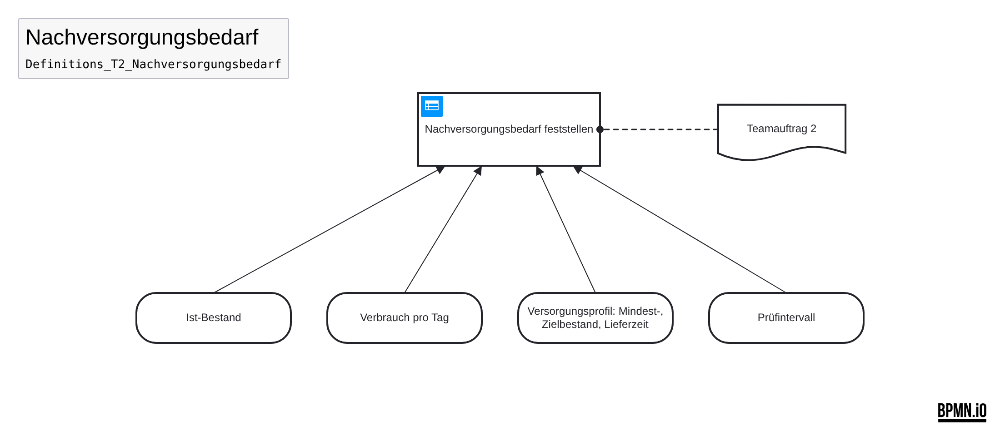
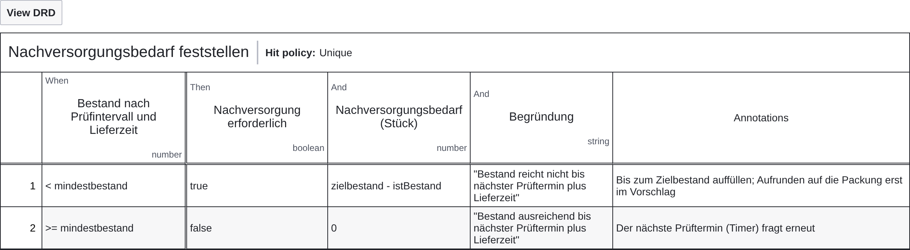
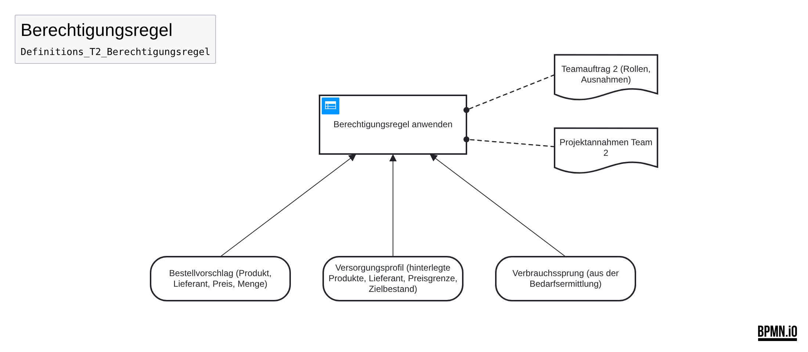
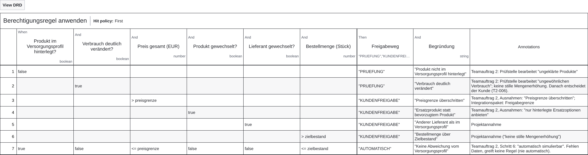

# Team 2 – Entscheidungstabellen (DMN)

> Verantwortlich im Team: Saifudin (T2-09, übernommen am 27.11.2026; erste Fassung von Mohammed).
>
> **Stand:** 24.11.2026. Getestet in einer Camunda-7.22-Engine im Speicher (Basis von CIB seven), siehe [Test](#test).

| Datei | Entscheidung (`decisionRef`) | Aufgerufen von | Hit Policy |
|---|---|---|---|
| `T2_Nachversorgungsbedarf.dmn` | `Nachversorgungsbedarf` | Regelaufgabe „Nachversorgungsbedarf feststellen“ (`T2_Materialversorgung`, Bedarfsermittlung) | UNIQUE |
| `T2_Berechtigungsregel.dmn` | `Berechtigungsregel` | Regelaufgabe „Berechtigungsregel anwenden“ (`T2_Bestellfreigabe`) | FIRST |

## Wie die Engine die Tabellen aufruft

Die beiden Regelaufgaben sind **keine External Tasks mehr**, sondern rufen die Tabelle direkt auf:

```xml
<bpmn:businessRuleTask id="T_Regel" name="Berechtigungsregel anwenden"
    camunda:decisionRef="Berechtigungsregel" camunda:decisionRefBinding="latest"
    camunda:mapDecisionResult="singleResult" camunda:resultVariable="berechtigungErgebnis">
```

Das Ergebnis ist eine Map in `berechtigungErgebnis` bzw. `bedarfErgebnis`. Je ein End-Listener kopiert die Spalten in einzelne Prozessvariablen (`freigabeweg`, `freigabeBegruendung` bzw. `nachversorgungErforderlich`, `nachversorgungsbedarf`, `bedarfsbegruendung`). Diese Variablen nutzen die Gateways danach.

**Warum so:** Die Tabelle läuft in der Engine, man sieht jede Auswertung im Cockpit (Decision History mit Ein- und Ausgaben), und es braucht keinen Worker. Die Regeln lassen sich ändern und neu deployen, ohne Code anzufassen (Projekthandbuch 5.6: Regeln bleiben veränderbar).

**Folge für die Worker:** Die Topics `t2-bedarf-feststellen` und `t2-berechtigung-pruefen` gibt es nicht mehr. Dafür müssen die Worker davor die Eingaben als Prozessvariablen setzen (siehe unten).

## 1. Nachversorgungsbedarf

**Frage:** Reicht der Bestand bis zum nächsten Prüftermin plus Lieferzeit?

**Eingaben** (setzt der Worker `t2-reichweite-berechnen` aus der eigenen Datenbank): `istBestand`, `verbrauchProTag`, `tageBisPruefung` (heute 10), `lieferzeitTage`, `mindestbestand`, `zielbestand`

| # | Bestand nach Prüfintervall und Lieferzeit<br>`istBestand − verbrauchProTag × (tageBisPruefung + lieferzeitTage)` | nachversorgungErforderlich | nachversorgungsbedarf | Begründung |
|---|---|---|---|---|
| 1 | `< mindestbestand` | true | `zielbestand − istBestand` | Bestand reicht nicht bis nächster Prüftermin plus Lieferzeit |
| 2 | `>= mindestbestand` | false | 0 | Bestand ausreichend … |




**Beispiel:** 60 Stück, 4 pro Tag, 10 + 3 Tage → 8 übrig < Mindestbestand 30 → nachversorgen, Bedarf 120 − 60 = 60. Aufgerundet auf die Packung wird erst in „Produkt und Menge vorschlagen“.

**Quelle:** Teamauftrag 2, Schritte 2–3 und Geschäftsobjekt „Nachversorgungsbedarf“. Mindestbestand als Grenze und „Prüfintervall + Lieferzeit“ als Vorlauf sind **Projektannahmen**.

## 2. Berechtigungsregel

**Frage:** Darf der Vorschlag automatisch (simuliert) bestellt werden, braucht er die Kundenfreigabe, oder muss die Prüfstelle draufschauen?

**Eingaben** (setzt der Worker `t2-vorschlag-erstellen`): `produktHinterlegt`, `produktGewechselt`, `lieferantGewechselt`, `preisGesamt`, `preisgrenze`, `bestellmenge`, `zielbestand`. `verbrauchssprung` kommt aus dem Hauptprozess.

**FIRST:** Die erste zutreffende Regel gewinnt. Die Regeln stehen von streng nach locker, also gewinnt immer der strengste Weg. (Camunda 7 kann die Hit Policy PRIORITY nicht, deshalb FIRST mit fester Reihenfolge.)

| # | Bedingung | freigabeweg | Begründung | Quelle |
|---|---|---|---|---|
| 1 | Produkt nicht im Versorgungsprofil hinterlegt | PRUEFUNG | Produkt nicht hinterlegt | Teamauftrag 2: Prüfstelle bearbeitet „ungeklärte Produkte“ |
| 2 | Verbrauch deutlich verändert | PRUEFUNG | Verbrauch deutlich verändert | Teamauftrag 2: Prüfstelle bearbeitet „ungewöhnlichen Verbrauch“; „keine stille Mengenerhöhung“ |
| 3 | `preisGesamt > preisgrenze` | KUNDENFREIGABE | Preisgrenze überschritten | Teamauftrag 2, Ausnahmen; Integrationspaket „Freigabegrenze“ |
| 4 | Ersatzprodukt statt bevorzugtem | KUNDENFREIGABE | Ersatzprodukt | Teamauftrag 2: „nur hinterlegte Ersatzoptionen anbieten“ |
| 5 | Anderer Lieferant | KUNDENFREIGABE | Anderer Lieferant | Projektannahme |
| 6 | `bestellmenge > zielbestand` | KUNDENFREIGABE | Menge über Zielbestand | Projektannahme zu „keine stille Mengenerhöhung“ |
| 7 | ausdrücklich keine Abweichung (Produkt hinterlegt, kein Verbrauchssprung, Preis ≤ Grenze, kein Produkt- oder Lieferantenwechsel, Menge ≤ Zielbestand) | AUTOMATISCH | Keine Abweichung | Teamauftrag 2, Schritt 6: „automatisch simulierbar“ |

Fehlt eine Eingabe, greift keine Regel. Der Prozess bleibt dann mit einem Incident stehen und gibt nie automatisch frei.




`freigabeBegruendung` geht als Anlass an die Prüfstelle (Formular „Grenzfall prüfen“) bzw. als Begründung an die Kundenentscheidung.

## Zusammenspiel BPMN und DMN

| Regelaufgabe im BPMN | Entscheidung (DMN) | Gateway danach | Ausgänge ↔ Ergebnis der Tabelle |
|---|---|---|---|
| „Nachversorgungsbedarf feststellen“ (in der Bedarfsermittlung) | „Nachversorgungsbedarf feststellen“ | „Nachversorgung erforderlich?“ (nach dem Teilprozess) | Ja ↔ `true`, Nein ↔ `false` |
| „Berechtigungsregel anwenden“ | „Berechtigungsregel anwenden“ | „Freigabeweg?“ | „Automatisch zulässig“ ↔ AUTOMATISCH, „Kundenfreigabe erforderlich“ ↔ KUNDENFREIGABE, „Prüfung erforderlich“ ↔ PRUEFUNG |

Die Regelaufgabe und die Entscheidung heißen gleich, und jedes Ergebnis der Tabelle hat genau einen Ausgang am Gateway. Die fünf Abweichungen aus Teamauftrag Schritt 5 (Preis, Produktwechsel, Verbrauchssprung, Lieferant, Menge) sind die Spalten der Berechtigungsregel. Deshalb gibt es keine eigene Aufgabe „Abweichungen prüfen“ mehr (Stiehl Punkt 11).

## Offene Punkte – bitte im Team klären

1. **Verbrauchssprung: Prüfstelle oder direkt Kunde?** Der Teamauftrag sagt beides: Die Prüfstelle bearbeitet „ungewöhnlichen Verbrauch“, die Ausnahmetabelle sagt „Entscheidung einholen“. Die Tabelle schickt ihn an die Prüfstelle. Weil die Prüfstelle nur „Kundenfreigabe einholen“ oder „nicht zulässig“ kann (T2-006), entscheidet der Kunde trotzdem immer mit. Die README sagte bisher „→ Kundenfreigabe“ und ist jetzt angepasst.
2. **Nur ein Grund:** Bei mehreren Abweichungen (z. B. Preis und Lieferant) steht nur der erste in `freigabeBegruendung`. Wenn der Kunde alle sehen soll, braucht es eine zweite Tabelle mit Hit Policy COLLECT.
3. **Gemeinsame Berechtigungsregel für Team 1 und 3 (T2-09):** Die Tabelle ist auf Bestellungen zugeschnitten (Preis, Produkt, Lieferant, Menge). Der Teamauftrag (2.2) verlangt aber, dass die Funktion „nicht ausschließlich auf Bestellungen zugeschnitten“ ist. Für Team 1 und 3 braucht es eine allgemeinere Fassung (z. B. Eingaben `handlungsart`, `betrag`, `grenze`). Das sollte in den Integrationskreis.
4. **DMN „Fristen“** (S10) gibt es noch nicht. Die Fristen stehen weiter fest im Modell.
5. Die Werte (Mindestbestand, Preisgrenze, Lieferzeit) kommen aus dem Versorgungsprofil in der Datenbank (T2-03) und sind damit je Haushalt konfigurierbar. Die Tabellen enthalten keine festen Zahlen.

## Test

`werkzeuge/dmn-test/` deployt alle 5 BPMN- und beide DMN-Dateien in eine Camunda-7.22-Engine im Speicher (H2) und prüft:

- beide Tabellen mit Beispielwerten (inkl. Grenzwerte; fehlende Daten ergeben nie AUTOMATISCH),
- im Prozess: Bestand reicht → Ende „Bestand ausreichend“; Vorschlag ohne Abweichung → weiter zur Bestellabwicklung; Preis zu hoch → Kundenentscheidung; Verbrauchssprung → Benutzeraufgabe „Grenzfall prüfen“ mit Begründung.

```bash
cd werkzeuge/dmn-test
mvn test
```

Ergebnis am 24.11.2026: 6 von 6 Tests grün. Der Deploy auf der echten CIB-seven-Engine des Teams steht noch aus.
