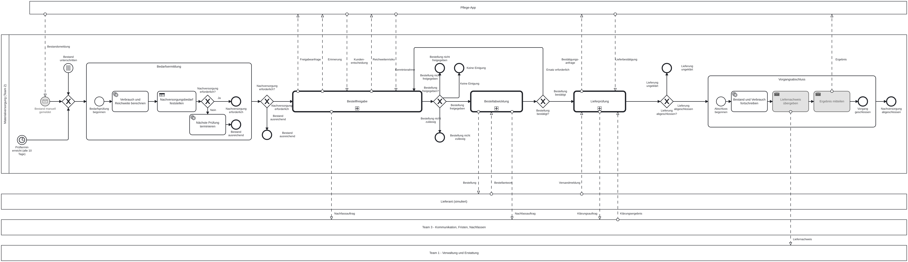

# Team 2 Materialversorgung – Erklärung des BPMN-Modells

> Verantwortlich: Saifudin Mohammadi (Modell erstellt, im Team mit Amar, Erion und Mohammed abgestimmt).

> **Stand:** 22.11.2026, überarbeitet nach der schriftlichen Rückmeldung von Prof. Stiehl (11 Punkte) · **Technik:** CIB seven (Camunda 7), External Tasks, JUEL · **Grundlage:** Teamauftrag 2, Projekthandbuch, Integrationspaket, Vorlesung „BPMN Best Practices“

---

## 1. Kurzüberblick

**Ziel (Teamauftrag 2):** Die Anwendung behält den Vorrat ausgewählter Verbrauchsprodukte im Blick und erkennt rechtzeitig Bedarf. Sie berücksichtigt Präferenzen und Grenzen, holt Entscheidungen ein und verfolgt die Lieferung bis zur Bestätigung.

**Eine Instanz von `T2_Materialversorgung`** ist ein Nachversorgungsvorgang für **ein Produkt eines Pflegehaushalts**.

**Leitfrage nach Stiehls Feedback:** *Wer ist das führende System?*
- **Unsere eigenen Daten:** Versorgungsprofil, Ist-Bestand, Regeln. Dafür nehmen wir Service- und Regelaufgaben.
- **Fremde Systeme:** Pflege-App, Lieferant, Team 1, Team 3. Mit ihnen arbeiten wir über Senden und Empfangen.

| Datei | Rolle | Teamauftrag-Schritte |
|---|---|---|
| `T2_Materialversorgung.bpmn` | **Hauptprozess:** 3 Starts; Prüfung auf offenen Vorgang; Bedarf (DMN) und Abschluss direkt im Fluss; 3 Call Activities | 1–12 |
| `T2_Bestellfreigabe.bpmn` | Vorschlag, Berechtigungsregel (DMN), Kundenentscheidung oder Prüfstelle | 4–7 |
| `T2_Kundenentscheidung.bpmn` | **Gemeinsamer Baustein** für Team 1, 2 und 3 | 7 |
| `T2_Bestellabwicklung.bpmn` | Bestellung per JMS senden, Antwort empfangen, über Team 3 nachfassen, Ersatzoption prüfen | 8–9 |
| `T2_Lieferpruefung.bpmn` | Versand, Lieferbestätigung über die App, Klärung über Team 3 | 9–10 |

Was sich nach dem Feedback geändert hat, steht in der README unter [Runde 2](README.md#runde-2-schriftliche-rückmeldung-von-stiehl-22112026) und [Runde 1](README.md#runde-1-feedback-beim-meilenstein-17112026).

---

## 2. Der Hauptprozess Schritt für Schritt

**Start (3 Auslöser laut Teamauftrag):**

| Startereignis | Art | Woher | Warum so |
|---|---|---|---|
| Prüftermin erreicht (alle 10 Tage) | Timer-Start, zyklisch (`R/P10D`) | Process Engine | Stiehl: Feature der Engine nutzen, kein eigener Prüflauf |
| Bestand manuell gemeldet | Nachrichtenstart | Pflege-App (Blackbox-Pool) | Die App ist ein eigenständiges System |
| Bestand unterschritten | Bedingter Start (`${bestandMenge < mindestbestand}`) | eigene Datenbank | Stiehl: Wir führen den Bestand selbst |

**Ablauf:**
1. Ein **sammelndes XOR** führt die 3 Startwege zusammen.
2. **„Laufenden Vorgang prüfen“** (Service-Aufgabe): Gibt es schon eine Instanz mit dem Business Key `PH-<Haushalt>:<Produkt>`? Wenn ja → Ende „Vorgang bereits offen“. So kann ein zweiter Start nicht doppelt bestellen (Stiehl Punkt 2).
3. **Bedarf feststellen** (direkt im Fluss, seit der Besprechung am 25.11. kein Teilprozess mehr):
   - „Verbrauch und Reichweite berechnen“ liest den Ist-Bestand aus der Datenbank.
   - Regelaufgabe „Nachversorgungsbedarf feststellen“: Die Engine wertet die DMN direkt aus (`decisionRef`), siehe [DMN.md](DMN.md).
   - **Ein** Ende „Bedarf ermittelt“. Der Teilprozess liefert nur Daten (`nachversorgungErforderlich`). Entschieden wird erst am Gateway danach (Stiehl Punkt 8). Bei „Nein“ → Ende „Bestand ausreichend“. Einen Folgetermin setzt niemand, das macht der zyklische Timer (Punkt 1).
4. Ein **XOR-Merge** vor der Bestellfreigabe nimmt auch die Ersatz-Schleife auf (Punkt 9).
5. **Bestellfreigabe** (Call Activity) endet mit einem von 4 Ergebnissen:
   - „Bestellung freigegeben“ → weiter
   - „Bestellung nicht freigegeben“, „Bestellung aufgeschoben“, „Bestellung nicht zulässig“ → je ein **Nachrichten-Endereignis „Ergebnis“** an die Pflege-App (Punkt 3)
6. **Bestellabwicklung** endet mit:
   - „Bestellung bestätigt“ → weiter
   - „Ersatz erforderlich“ → unten zurück zum XOR vor der Bestellfreigabe, mit `ersatzGrund` und `anzahlBestellversuche`
   - „Keine Bestellung möglich“ → Nachrichten-Endereignis „Ergebnis“
7. **Lieferprüfung** endet mit „Lieferung abgeschlossen“ → weiter, oder „Lieferung ungeklärt“ → Nachrichten-Endereignis „Ergebnis“ (an die Prüfstelle übergeben).
8. **Abschluss** (direkt im Fluss): Bestand fortschreiben, Liefernachweis an Team 1, Ergebnis an die Pflege-App, danach Ende „Nachversorgung abgeschlossen“.

**Warum wird der Bestand nur im Erfolgsfall fortgeschrieben?** (Stiehl Punkt 3) Ohne Lieferung ändert sich der Bestand nicht. Fortgeschrieben wird bei jedem Abbruch aber der **Vorgang** (Zustand und Grund), und zwar im Worker des Nachrichten-Endereignisses `t2-ergebnis-mitteilen`.

**Label-Matching (Stiehl, Regeln 10–12):** Jedes Endereignis eines Teilprozesses setzt per Execution Listener eine Ergebnisvariable mit seinem eigenen Namen, z. B. `bestellfreigabeErgebnis = 'Bestellung aufgeschoben'`. Das Gateway danach prüft genau diesen Text.

**Warum kein eingebetteter Teilprozess mehr?** Stiehl in der Besprechung am 25.11.: Ein Teilprozess lohnt sich nur bei Schleifenmarkierung, Boundary-Event oder komplexer Logik. Frühere Regel:
- **Wenige Schritte** werden eingebettet und **aufgeklappt** (bei uns nicht mehr verwendet).
- **Viele Schritte** werden eine Call Activity in eigener Datei. Nur dort lassen sich eigene Pools und Blackbox-Pools zeichnen.
- Zugeklappte eingebettete Teilprozesse sind nur „Visual Sugar“ und haben nur Nachteile.

---

## 3. Die Teilprozesse

| Teilprozess | Ablauf (kurz) | Partner | Besonderheiten |
|---|---|---|---|
| **Bestellfreigabe** | Vorschlag → Berechtigungsregel (DMN ermittelt Abweichungen und Freigabeweg) → automatisch, Kundenfreigabe oder Prüfstelle | Pflege-App, Team 3; Lanes „automatisiert“ und „menschliche Prüfstelle“ | Eine Abweichung führt nicht zur Ablehnung, sondern zu einer **menschlichen Entscheidung**. Die Prüfstelle kann nur „Kundenfreigabe einholen“ oder „nicht zulässig“, nie ohne Kunde freigeben (T2-006). „Änderung gewünscht“ → neuer Vorschlag, höchstens 3, sonst „nicht freigegeben“ (Grund „Keine Einigung“). 4 Enden, alle über XOR-Merges. |
| **Kundenentscheidung** | Senden „Freigabeanfrage senden“ → Empfangen „Kundenentscheidung empfangen“ → Freigegeben, Änderung gewünscht, Aufgeschoben oder Nicht freigegeben | Pflege-App, Team 3 | Frist 3 Tage → „Bereits nachgefasst?“ → Nein: „Nachfassen beauftragen“ (Team 3) und erneut warten; Ja: „Nicht freigegeben“ mit Grund „keine Antwort“. **Wiederverwendbar** für Team 1 und 3. |
| **Bestellabwicklung** | Senden „Bestellung übermitteln“ (JMS) → Empfangen „Bestellantwort empfangen“ mit angehängtem Timer | Lieferant, Team 3 | Happy Path gerade durch. Nach Fristablauf einmal Nachfassen über Team 3. Nicht verfügbar oder weiter keine Antwort → „Ersatzoption prüfen“ → „Ersatz erforderlich“ oder „Keine Bestellung möglich“. |
| **Lieferprüfung** | Empfangen „Versandmeldung“ → Senden „Lieferbestätigung anfordern“ → Empfangen „Lieferbestätigung empfangen“ → richtig oder Abweichung | Lieferant, Pflege-App, Team 3 | Abweichung oder abgelaufene Frist → „Klärung beauftragen“ (Team 3). Abgeschlossen nur bei bestätigter Nachlieferung. Sicherheitsfrist 7 Tage für das Klärungsergebnis. |

---

## 4. Technische Umsetzung in CIB seven (Camunda 7)

| Thema | Umsetzung im Modell |
|---|---|
| Teilprozesse | Call Activities mit `calledElementBinding="latest"`, **Call by Value** über `camunda:in`/`camunda:out`. Eingebettete Teilprozesse (`subProcess`) sehen die Variablen des Hauptprozesses direkt. |
| Nachrichten-Endereignisse | Jedes Abbruch-Ende: `messageEventDefinition camunda:type="external" camunda:topic="t2-ergebnis-mitteilen"`. Ein Worker sendet das Ergebnis an die App und schreibt den Vorgangszustand fort. |
| Business Key | `PH-<Haushalt>:<Produkt>`. „Laufenden Vorgang prüfen“ sucht per `GET /process-instance?businessKey=…` |
| Aufgaben | Service-, Sende- und Regelaufgaben als **External Tasks** (`camunda:type="external"`, eigenes Topic `t2-…`). Einzige Benutzeraufgabe: „Grenzfall prüfen“ (Prüfstelle, `candidateGroups="pruefstelle"`). |
| Empfangen | Empfangen-Aufgaben mit `messageRef`, Korrelation per REST `POST /message` (Nachrichtenname + `vorgangId`/Business Key), später über Camel |
| Bedingter Start | `conditionalEventDefinition`. Auslösen per REST `POST /condition` mit den Variablen `bestandMenge` und `mindestbestand`, nach jeder Bestandsänderung (die Engine überwacht keine Tabellen) |
| Timer-Start | `timeCycle` `R/P10D` (alle 10 Tage, unbegrenzt wiederholt) |
| Pflicht laut Projektvorgaben | Sendeaufgabe „Bestellung übermitteln“ → JMS-Queue → Camel (CBR, XML↔JSON). Rückweg „Bestellantwort empfangen“ über Camel. **Esper:** Einsatz offen (siehe 6). |
| Zeiten | ISO-8601-Dauern (P1D, P3D, P5D, P7D) |
| Betrieb | `camunda:historyTimeToLive="P180D"` an jedem Prozess |
| Prüfung | XSD (BPMN 2.0, OMG), bpmnlint, `werkzeuge/stilcheck.py`, Logikprüfung. **Kein Deploy-Test auf einer laufenden Engine bisher.** |

**Wichtige Variablen:**
- Kennungen: `pflegehaushaltId`, `vorgangId`, `produktId`
- Bestand und Bedarf: `bestandMenge`, `mindestbestand`, `nachversorgungsbedarf`, `verbrauchssprung`
- Vorgang: `vorgangOffen`, `vorgangszustand`, `ablehnungsgrund`
- Freigabe: `freigabeweg`, `bestellvorschlag`, `anzahlVorschlaege`, `anzahlBestellversuche`, `entscheidung`, `kundenentscheidungErgebnis`, `kundenentscheidungGrund`, `nachgefasst`
- Bestellung und Lieferung: `bestellantwortStatus`, `ersatzGrund`, `ersatzMoeglich`, `lieferbefund`, `klaerungsergebnis`
- Ergebnisvariablen `…Ergebnis` aus den Endereignissen der Teilprozesse

---

## 5. Bekannte Schwächen und wie man sie besser macht

| Nr | Schwäche | Verbesserung | Wer |
|---|---|---|---|
| S1 | **Timer-Start ohne Haushalt und Produkt:** Ein zyklischer Timer erzeugt je Zyklus eine Instanz, nicht je Profil. | Mit Stiehl klären, z. B. Timer je Versorgungsprofil oder Ermittlung der fälligen Profile direkt nach dem Start | Stiehl |
| S2 | ~~Doppelte Vorgänge möglich~~ | **Erledigt (Runde 2):** „Laufenden Vorgang prüfen“ mit Business Key | – |
| S3 | **Esper kommt nicht mehr vor**, obwohl Eventing Pflicht ist. | Esper z. B. für die Verbrauchsprognose oder für das Erkennen ausbleibender Rückmeldungen nutzen | Stiehl/Integrationskreis |
| S4 | **Kreuzung in der Bestellfreigabe:** „Automatisch zulässig“ kreuzt die drei Nachrichtenflüsse der Kundenentscheidung. | Ohne Kreuzung bräuchte man ein zweites Ende „Bestellung freigegeben“ (gegen Regel 16/17). Wir lassen die Kreuzung bewusst stehen. | Team 2 |
| S5 | ~~Kunde nicht bei jedem Ende informiert~~ | **Erledigt (Runde 2):** Nachrichten-Endereignis „Ergebnis“ an jedem Abbruch | – |
| S6 | **Gemeinsame Vorgangszustände** werden nur intern gesetzt (`vorgangszustand`). | An Team 1 melden, sobald das Format abgestimmt ist | Team 2 + Team 1 |
| S7 | **Technische Ausnahmen fehlen** (Gegenkomponente nicht erreichbar, doppelte Ereignisse) | Error-Boundary-Event an Sendeaufgaben (`handleBpmnError`), Retries, `ereignisId` auf Duplikate prüfen | Team 2 |
| S8 | **Keine Transaktionsgrenzen** (`asyncBefore`/`asyncAfter`) | `asyncBefore` an Starts und vor Call Activities | Team 2 |
| S9 | **Keine Quittung von Team 1** auf den Liefernachweis | Antwort „Dokument eingegangen“ abwarten (Empfangen mit Frist) | Team 1 + 2 |
| S10 | **Fristen fest im Modell** | Fristen aus DMN „Fristen“ oder Konfiguration lesen | Team 2 |

---

## 6. Offene Punkte – im Integrationskreis bzw. mit Stiehl abstimmen

- **Timer-Start und Instanz-Zuordnung** (S1) und **Einsatz von Esper** (S3)
- Ob Team 1 und 3 die Kundenentscheidung über die Pflege-App mitnutzen (Senden/Empfangen statt Benutzeraufgabe)
- Inhalt und Antworten von Nachfassauftrag und Klärungsauftrag (Team 3), insbesondere `NACHLIEFERUNG_BESTAETIGT`/`NICHT_GEKLAERT`
- Wer betreibt die Pflege-App, und wer empfängt „Klärungsfall übergeben“?
- Gemeinsame Kennungen (`PH-…`, `VG-T2-…`, `korrelationsId`) und der Ereignisrahmen (Integrationspaket 6.5)
- Eine gemeinsame CIB-seven-Engine für alle 3 Teams oder getrennte Engines?

### Technische Fragen
| Nr | Frage | Warum wichtig |
|---|---|---|
| T1 | Korrelation: Ruft Camel die REST-API `POST /engine-rest/message` auf, oder gibt es einen eigenen Quarkus-Endpunkt? | Betrifft alle Empfangen-Aufgaben und den Nachrichtenstart |
| T2 | Wer löst den bedingten Start aus (`POST /condition`): der Worker „Bestand fortschreiben“ oder ein eigener Dienst? | Ohne Auslösen startet der bedingte Start nie |
| T3 | Worker-Technik: External-Task-Client in Quarkus (Java)? | Frameworks mit dem Dozenten absprechen |
| T4 | JMS-Queues und CBR-Ziele, Format (XML oder JSON) | Pflichtpunkt Messaging und Integration |
| T5 | Persistenz: eigenes MySQL-Schema oder gemeinsames Datenmodell (Team 1)? | Versorgungsprofil und Bestand liegen bei uns |
| T6 | Ein gemeinsames Deployment oder je Team? | Namenskonflikte bei Prozess-IDs und Nachrichten |

---

## 7. Mögliche Prüfungsfragen – mit Kurzantwort

| Frage | Kurzantwort |
|---|---|
| Wann Service-Aufgabe, wann Senden/Empfangen? | Wer ist das führende System? Eigenes System und eigene Daten → Service-Aufgabe. Fremdes System (App, Lieferant, andere Teams) → Senden und Empfangen. |
| Warum ist die Pflegeperson keine Bahn mehr? | Sie arbeitet über die Pflege-App, also ein eigenständiges System. Eine Benutzeraufgabe würde in der Tasklist der Engine landen. Deshalb senden wir an die App und warten mit einer Empfangen-Aufgabe auf die Antwort. |
| Warum keine Bestandsabfrage mehr? | Den Ist-Bestand führen wir selbst in der Datenbank. Ihn noch einmal bei der Person abzufragen, wäre doppelt. |
| Was ist ein bedingter Start, und wie funktioniert er in CIB seven? | Ein Startereignis mit einer Bedingung (`Bestand < Mindestbestand`). Die Engine prüft sie nicht von selbst. Nach jeder Bestandsänderung ruft man `POST /condition` auf, und ist die Bedingung wahr, startet eine Instanz. |
| Ereignisbasiertes Gateway oder Empfangen-Aufgabe mit Timer? | Sind beide Ausgänge etwa gleich wahrscheinlich, nimmt man das Gateway. Gibt es einen klaren Happy Path (etwa 80:20), nimmt man die Empfangen-Aufgabe mit angehängtem Timer. Dann läuft der Normalfall sichtbar gerade durch. |
| Call Activity oder eingebetteter Teilprozess? | Viele Schritte oder Wiederverwendung → Call Activity (eigene Datei, Pools und Blackboxen möglich, Call by Value). Wenige Schritte → eingebettet und aufgeklappt (sieht die Variablen des Hauptprozesses). |
| Unterbrechender vs. nicht unterbrechender Timer? | Nicht unterbrechend: Die Aufgabe bleibt aktiv, zusätzlich entsteht ein Token (z. B. Erinnerung). Unterbrechend: Die Aufgabe wird abgebrochen. Wir nutzen nur unterbrechende Timer: Frist abgelaufen → Nachfassen über Team 3 → zurück zum Warten. |
| Führt eine Abweichung zur Ablehnung? | Nein. Sie führt zu einer menschlichen Entscheidung durch den Kunden oder die Prüfstelle. Ohne Abweichung wird automatisch freigegeben. |
| Wie verhindert ihr Endlosschleifen? | Höchstens 3 Vorschläge (`anzahlVorschlaege`). Die Ersatz-Schleife begrenzt „Ersatzoption prüfen“ (höchstens 2 Bestellversuche), danach „Keine Bestellung möglich“. Nachfassen nur einmal (`nachgefasst`). |
| Wie verhindert ihr doppelte Bestellungen? | Nach jedem Start prüft „Laufenden Vorgang prüfen“, ob schon eine Instanz mit Business Key `PH-<Haushalt>:<Produkt>` läuft. |
| Warum entscheidet ein Gateway nach der DMN? | Die DMN liefert nur Daten (`nachversorgungErforderlich`), das Gateway entscheidet (Regel 20). Früher steuerten scheinbar die Enden des Teilprozesses. Deshalb hat er nur ein Ende und liefert Daten; das Gateway entscheidet auf `nachversorgungErforderlich`. |
| Warum ein Nachrichten-Endereignis statt „Ergebnis mitteilen“ als Aufgabe vor dem Ende? | Es ist dieselbe Semantik mit einem Element weniger: Das Ende sendet die Nachricht. In CIB seven läuft es als External Task. |
| Warum kann die Prüfstelle nicht ohne Kunde freigeben? | Bewusste Entscheidung (T2-006): Jede Abweichung betrifft den Kunden (Preis, Produkt, Menge), also entscheidet er. |
| Wie stellt ihr Label-Matching sicher? | Ein Endereignis-Listener setzt `<teilprozess>Ergebnis` = Name des Endereignisses. Das Out-Mapping gibt ihn zurück, und das Gateway prüft genau diesen Text. |
| Was passiert, wenn ein Worker ausfällt? | Der External Task wird nach Ablauf des Locks erneut geholt (Retries). Bei 0 Retries wird er zum Incident im Cockpit. |
| Wie erfüllt ihr Messaging und Integration? | Sendeaufgabe → JMS-Queue → Camel (CBR, XML↔JSON) → simulierter Lieferant. Die Antwort kommt über Camel zur Empfangen-Aufgabe. |
| Ist-Bestand und Zielbestand? | Der Ist-Bestand ist, was da ist (Datenbank). Der Zielbestand steht im Versorgungsprofil. Bestellmenge = Zielbestand − Ist-Bestand, aufgerundet auf die Packung. |
