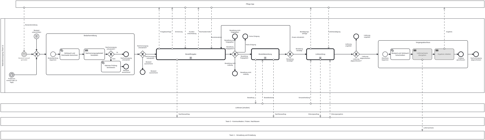

# Team 2 – Materialversorgung: BPMN-Modell

> **KI-Kennzeichnung (Kursregel):** Modelle, Bilder und dieser Text wurden mit KI-Unterstützung erstellt (Claude, Anthropic) und müssen von Team 2 geprüft werden. Wer im Team welchen Teil verantwortet, ist noch offen. Das Team trägt es in die `documentation` der Prozesse und hier ein.
>
> **Stand:** 17.11.2026, **überarbeitet nach dem Feedback von Prof. Stiehl beim Meilenstein** (siehe [Nach dem Feedback verbessert](#nach-dem-feedback-verbessert)). **Grundlage:** Teamauftrag 2, Gemeinsames Projekthandbuch, Integrations- und Organisationspaket (alle v1.0) und die Vorlesung „BPMN Best Practices“ (Method & Style). **Technik:** CIB seven (Camunda 7), External Tasks, JUEL. DMN, Simulator und Tests kommen später.

> **Ausführliche Erklärung, Schwächen, Verbesserungen und offene (technische) Fragen:** [MODELL_ERKLAERUNG.md](MODELL_ERKLAERUNG.md)

## Überblick

| Datei | Inhalt | Teamauftrag-Schritte |
|---|---|---|
| `T2_Materialversorgung.bpmn` | **Hauptprozess:** 3 Starts, Bedarfsermittlung und Vorgangsabschluss aufgeklappt eingebettet, 3 Call Activities, 6 Endzustände | 1–12 |
| `T2_Bestellfreigabe.bpmn` | Vorschlag, Abweichungen, Berechtigungsregel, Kundenentscheidung, Reichweitenrisiko mit Quittung | 4–7 |
| `T2_Kundenentscheidung.bpmn` | **Gemeinsamer Baustein** für Team 1, 2 und 3 (Senden/Empfangen über die Pflege-App) | 7 |
| `T2_Bestellabwicklung.bpmn` | Bestellung senden (JMS), Antwort empfangen, Nachfassen über Team 3 | 8–9 |
| `T2_Lieferpruefung.bpmn` | Versand, Lieferbestätigung über die App, Klärung über Team 3 | 9–10 |

Eine Instanz entspricht einem Nachversorgungsvorgang für ein Produkt eines Pflegehaushalts. **Den Ist-Bestand führt Team 2 selbst in der eigenen Datenbank** (führendes System).



## Nach dem Feedback verbessert

Feedback von Prof. Stiehl bei der Vorstellung des Modells (Meilenstein). Seine Kernaussage: *Die Pflege-App ist ein eigenständiges System. Mit ihr arbeiten wir über Senden und Empfangen, nicht über Service-Aufgaben.* Gesamturteil: „sehr gut aufgedröselt“, aber „die Realität nicht verlieren“.

| Nr | Feedback von Stiehl | Vorher | Jetzt | Team 1/3 betroffen? |
|---|---|---|---|---|
| 1 | „Der regelmäßige Lauf ist ein Timer-Ereignis … zyklisch alle 10 Tage. Dann braucht ihr keinen Prüflauf.“ | Eigener Prozess `T2_Prueflauf` mit Mehrfach-Sendeaufgabe | **Zyklischer Timer-Start** „Prüftermin erreicht (alle 10 Tage)“ im Hauptprozess. Prüflauf gelöscht. | Nein |
| 2 | „Ihr führt den Lagerbestand selbst … dafür gibt es das **bedingte Startereignis**.“ | Nachrichtenstart von Esper | **Bedingter Start** „Bestand unterschritten“ (`${bestandMenge < mindestbestand}`). Pool Esper gelöscht. | Nein |
| 3 | „Den Bestand habt ihr in der Datenbank. Warum soll die Person ihn nochmal eingeben?“ | Teilprozess Bestandsabfrage mit Erinnerung, Meldefrist, Ende „Keine Bestandsmeldung“ | **Bestandsabfrage gestrichen.** Der Bestand wird aus der Datenbank gelesen. Die Pflegeperson meldet nur noch Abweichungen über die App. | Nein |
| 4 | „Die Pflegeperson hat eine App. Dann sendet man eine Nachricht an die App und wartet auf die Antwort.“ Eine Benutzeraufgabe in der Tasklist ist „immer das Komplizierte“. | Bahn „Pflegeperson“ mit Benutzeraufgaben (Freigabe entscheiden, Lieferung prüfen) | **Senden-Aufgabe** an den Pool „Pflege-App“ und **Empfangen-Aufgabe** für die Antwort (Kundenentscheidung, Lieferbestätigung). Erinnerung und Frist hängen als Timer an der Empfangen-Aufgabe. | **Ja**, die Kundenentscheidung ist ein gemeinsamer Baustein. Nur Vorschlag. |
| 5 | „Reichweitenrisiko mitteilen sieht nach einer Sendenachricht aus.“ | Service-Aufgaben mit Topic `t2-benachrichtigung` | Alle Mitteilungen an die Pflegeperson sind **Senden-Aufgaben** an die Pflege-App (Freigabeanfrage, Erinnerung, Reichweitenrisiko, Bestätigungsanfrage, Ergebnis). | Nein |
| 6 | „Verlangt ihr dort eine **Quittung**? … explizit zurückmelden und gegebenenfalls nachhaken.“ | Reichweitenrisiko ohne Rückmeldung | Empfangen-Aufgabe „Kenntnisnahme empfangen“. Nach 2 Tagen ohne Quittung **Nachfassauftrag an Team 3**. | **Ja, Team 3** (neuer Nachfassauftrag). Nur Vorschlag. |
| 7 | Bei einem eindeutigen Happy Path (etwa 80:20) Senden + **Empfangen-Aufgabe mit angehängtem Timer** statt ereignisbasiertem Gateway. | Ereignisbasiertes Gateway in der Bestellabwicklung | Empfangen-Aufgabe „Bestellantwort empfangen“ mit unterbrechendem Timer (1 Tag). | Nein |
| 8 | Viele Schritte → Call Activity in eigener Datei. **Wenige Schritte → eingebettet und aufgeklappt** (zugeklappt ist nur „Visual Sugar“). | Bedarfsermittlung und Vorgangsabschluss als eigene Dateien | Beide als **aufgeklappte eingebettete Teilprozesse** im Hauptprozess. Die Dateien sind gelöscht. | Nein |

**Zusätzlich verbessert (eigene Logikprüfung, beim Meilenstein selbst angesprochen):**

| Nr | Problem | Lösung | Team 1/3 betroffen? |
|---|---|---|---|
| 9 | Die Schleife „Ersatz erforderlich“ hatte keine Obergrenze. | Zähler `anzahlBestellversuche`. Ab dem 2. Versuch setzt die Berechtigungsregel den Weg „Prüfung“ (menschliche Prüfstelle). | Nein |
| 10 | „Geklärt“ führte direkt zu „Lieferung abgeschlossen“, auch wenn nichts geliefert wurde. | Abgeschlossen nur bei `klaerungsergebnis = NACHLIEFERUNG_BESTAETIGT`, sonst Übergabe an die Prüfstelle. | **Ja, Team 3** (Rückgabewerte der Klärung). Nur Vorschlag. |
| 11 | Beim Warten auf das Klärungsergebnis fehlte eine Frist. | Empfangen-Aufgabe mit Sicherheitsfrist 7 Tage, danach Übergabe an die Prüfstelle. | Nein |

## Prozessgrenze
- **Start (3 Auslöser laut Teamauftrag):**
  - „Prüftermin erreicht (alle 10 Tage)“: zyklischer **Timer-Start** (`R/P10D`)
  - „Bestand manuell gemeldet“: **Nachrichtenstart** ← Pflege-App, Nachricht `PflegeApp_Bestandsmeldung_Team2`
  - „Bestand unterschritten“: **bedingter Start** auf den Bestand in der eigenen Datenbank. In CIB seven nach jeder Bestandsänderung per REST `POST /condition` auslösen, weil die Engine die Tabelle nicht selbst überwacht.
- **Endzustände (Hauptprozess):**

| Endereignis | Gemeinsamer Vorgangszustand (Handbuch 7.2) |
|---|---|
| Nachversorgung abgeschlossen | Erfolgreich abgeschlossen |
| Bestand ausreichend | Erfolgreich abgeschlossen (nächste Prüfung terminiert) |
| Bestellung nicht freigegeben | Erfolglos abgeschlossen (Reichweitenrisiko mitgeteilt) |
| Bestellung nicht zulässig | Erfolglos abgeschlossen (Begründung der Prüfstelle) |
| Keine Einigung | Erfolglos abgeschlossen (nach 3 Vorschlägen keine Freigabe) |
| Lieferung ungeklärt | Übergeben (an die menschliche Prüfstelle) |

Die Zuordnung zu den Zuständen ist ein Vorschlag für den Integrationskreis.

## Pflicht-Ausnahmen (Teamauftrag Abschnitt 5)

| Situation | Wo im Modell |
|---|---|
| Bestand nicht gemeldet | **Entfällt nach Stiehls Feedback:** Den Bestand führt Team 2 selbst. Es wird nicht mehr bei der Pflegeperson abgefragt (Entscheidung T2-003). |
| Verbrauch deutlich verändert | Bedarfsermittlung markiert `verbrauchssprung` → Bestellfreigabe: Abweichung → Kundenfreigabe (keine stille Mengenerhöhung) |
| Preisgrenze überschritten | Bestellfreigabe: „Abweichungen prüfen“ + „Berechtigungsregel anwenden“ → Kundenentscheidung |
| Bevorzugtes Produkt nicht verfügbar | Bestellabwicklung → „Ersatz erforderlich“ → zurück zur Bestellfreigabe, nur hinterlegte Ersatzoptionen, ab dem 2. Versuch Prüfstelle |
| Lieferant antwortet nicht | Bestellabwicklung: Antwortfrist → Nachfassen über Team 3 → nach erneuter Frist „Ersatz erforderlich“ |
| Teil- oder Falschlieferung | Lieferprüfung: „Abweichung festgestellt“ → Klärung über Team 3, Status bleibt offen |
| Kunde lehnt ab oder verschiebt | Kundenentscheidung „Nicht freigegeben“ → „Reichweitenrisiko mitteilen“ mit Quittung, keine Bestellung |
| *(Ergänzung)* Kunde wünscht immer wieder Änderungen | Bestellfreigabe: höchstens 3 Vorschläge, danach Ende „Keine Einigung“ |
| Lieferung bleibt unbestätigt | Lieferprüfung: Bestätigungsfrist → Klärung, sonst „Lieferung ungeklärt“, nie automatisch erfolgreich |

## Umgesetzte Best Practices (Stiehl, Method & Style)
- **Führendes System entscheidet den Aufgabentyp:** Eigene Daten (Versorgungsprofil, Bestand, Regeln) → Service- und Regelaufgaben. Fremde Systeme (Pflege-App, Lieferant, Team 1, Team 3) → Senden und Empfangen.
- **Methode top-down:** Hauptprozess mit höchstens 10 Aktivitäten. Große Teilprozesse sind Call Activities in eigener Datei (Call by Value mit `camunda:in`/`camunda:out`), kleine sind eingebettet und aufgeklappt.
- **Label-Matching (Regeln 10–12):** Die Endereignisse jedes Teilprozesses heißen genau wie die Ausgänge des folgenden Gateways. Jedes Endereignis setzt per Execution Listener `<teilprozess>Ergebnis = '<Name des Endereignisses>'`.
- **Nachrichtenflüsse:** Sie sind in Eltern- und Kindebene gleich beschriftet (Regel 14). Jede Sende- und Empfangsaufgabe hat einen Nachrichtenfluss (Regel 13). Partner sind Blackbox-Pools.
- **Happy Path sichtbar:** Empfangen-Aufgabe mit angehängtem Timer, wo die Antwort der Normalfall ist.
- **Warten mit Erinnern:** nicht unterbrechender Timer für die Erinnerung, unterbrechender Timer für die endgültige Frist. „Keine Antwort“ ist nie eine Freigabe.
- **Gateway entscheidet nicht (Regel 20):** Davor liegt immer eine Aufgabe oder Regel, die das Ergebnis erzeugt.
- **Integration grau markiert:** Senden, Empfangen, Aufträge an andere Teams.
- **Pflichtpunkte aus den Projektvorgaben:** Die Sendeaufgabe „Bestellung übermitteln“ schreibt in eine JMS-Queue (Camel/CBR). Die Antwort des Backends kommt über Camel zurück.
- **Sammelndes XOR** steht nur dort, wo 3 Linien zusammenkommen (nach den 3 Starts, vor „Klärung beauftragen“). Grund ist unsere Projektregel: höchstens 2 Linien in eine Aufgabe.

## Schnittstellen – nur Vorschlag, im Integrationskreis abstimmen

| Richtung | Nachricht / Funktion | Element |
|---|---|---|
| Pflege-App → Team 2 | `PflegeApp_Bestandsmeldung_Team2` (abweichender Ist-Bestand) | Nachrichtenstart im Hauptprozess |
| Team 2 → Pflege-App | Freigabeanfrage, Erinnerung, Reichweitenrisiko, Bestätigungsanfrage, Ergebnis | Sendeaufgaben (Topics `t2-…-senden`/`-mitteilen`/`-anfordern`) |
| Pflege-App → Team 2 | `PflegeApp_Kundenentscheidung_Team2` (`entscheidung`), `PflegeApp_Kenntnisnahme_Team2`, `PflegeApp_Lieferbestaetigung_Team2` (`lieferbefund`) | Empfangen-Aufgaben |
| Team 2 → Lieferant (simuliert) | `Bestellung` (JMS) | Sendeaufgabe `t2-bestellung-senden` |
| Lieferant → Team 2 | `Lieferant_Bestellantwort_Team2` (`BESTAETIGT`/`NICHT_VERFUEGBAR`), `Lieferant_Versandmeldung_Team2` | Empfangen-Aufgaben |
| Team 2 → Team 3 | Nachfassauftrag (Lieferant antwortet nicht; Quittung zum Reichweitenrisiko fehlt) | `t2-nachfassen-beauftragen` |
| Team 2 → Team 3 | Klärungsauftrag (Abweichung, Gegenstelle) | `t2-klaerung-beauftragen` |
| Team 3 → Team 2 | `Team3_Klaerungsergebnis_Team2` (`NACHLIEFERUNG_BESTAETIGT` oder `NICHT_GEKLAERT`) | Empfangen-Aufgabe |
| Team 2 → Team 1 | Liefernachweis (Pflegehaushalt, Bestellung, Herkunft, Ergebnis) | `t2-nachweis-uebergeben` |
| Team 2 → Team 1/3 | **Kundenentscheidung** als Call Activity `T2_Kundenentscheidung` (Ein: `freigabeHandlung`, `freigabeBegruendung`, `freigabeFolgen`, `freigabeGueltigBis`; Aus: `kundenentscheidungErgebnis`, `kundenentscheidungKommentar`) | eigener Prozess |

Jede teamübergreifende Nachricht soll den gemeinsamen Ereignisrahmen tragen (Integrationspaket 6.5): `ereignisId`, `ereignistyp`, `zeitpunkt`, `quelle`, `pflegehaushaltId`, `vorgangId`, `korrelationsId`, `schemaVersion`, `nutzdaten`.

## Projektannahmen – nicht von Stiehl vorgegeben
- Fristen: Erinnerung 1 Tag, Antwortfrist Kunde 3 Tage, Quittung Reichweitenrisiko 2 Tage, Antwortfrist Lieferant 1 Tag (einmal nachfassen), Versandfrist 5 Tage, Bestätigungsfrist 3 Tage, Klärungsfrist 7 Tage. Prüftermin alle 10 Tage (Beispiel von Stiehl). Die Werte werden später konfigurierbar (DMN „Fristen“).
- Höchstens 3 Vorschläge je Bestellfreigabe, danach Ende „Keine Einigung“.
- Ab dem 2. Bestellversuch entscheidet die menschliche Prüfstelle.

## Offen (Stiehl/Integrationskreis)
- **Timer-Start und Instanz:** Ein Timer-Start erzeugt je Zyklus eine Instanz ohne Haushalt und Produkt. Wie werden die fälligen Versorgungsprofile zugeordnet?
- **Esper:** Laut Projektvorgaben ist Eventing Pflicht. Der Schwellenwert läuft jetzt über den bedingten Start. Wo setzen wir Esper ein, z. B. für die Verbrauchsprognose?
- **Doppelte Vorgänge:** Eine manuelle Meldung kann zusätzlich den bedingten Start auslösen. Vor dem Start prüfen, ob schon ein offener Vorgang je Haushalt und Produkt läuft.
- Gemeinsame Kennungen (`PH-…`, `VG-T2-…`) und Nachrichtenformate
- Wie Team 1 und 3 die Kundenentscheidung aufrufen: Call Activity in derselben Engine oder per Nachricht
- Wer betreibt die Pflege-App, und wer ist Empfänger von „Klärungsfall übergeben“?

## Prüfung (17.11.2026)
- XSD-Prüfung gegen das offizielle BPMN-2.0-Schema: 5/5 gültig
- bpmnlint (recommended): 0 Fehler (nur Hinweise)
- Eigener Stilcheck (`werkzeuge/stilcheck.py`): Label-Matching, Nachrichtenflüsse Eltern/Kind, höchstens 10 Aktivitäten, höchstens 2 eingehende Linien, Camunda-Pflichtattribute → keine Fehler
- Logikprüfung: Jeder Schritt ist erreichbar, jeder Weg führt zu einem Ende
- Bekannte Stelle: In der Bestellfreigabe kreuzt die Linie „Automatisch zulässig“ drei Nachrichtenflüsse zur Kundenentscheidung. Ohne Kreuzung bräuchte man zwei gleichnamige Endereignisse (gegen Regel 16/17).
- **Noch nicht gemacht:** Deploy auf einer laufenden CIB-seven-Engine. Bitte lokal prüfen:

```bash
cd prozesse/team2
curl -s -X POST http://localhost:8080/engine-rest/deployment/create \
  -F deployment-name=team2-bpmn -F enable-duplicate-filtering=true \
  $(for f in *.bpmn; do echo -n "-F $f=@$f "; done)
```
